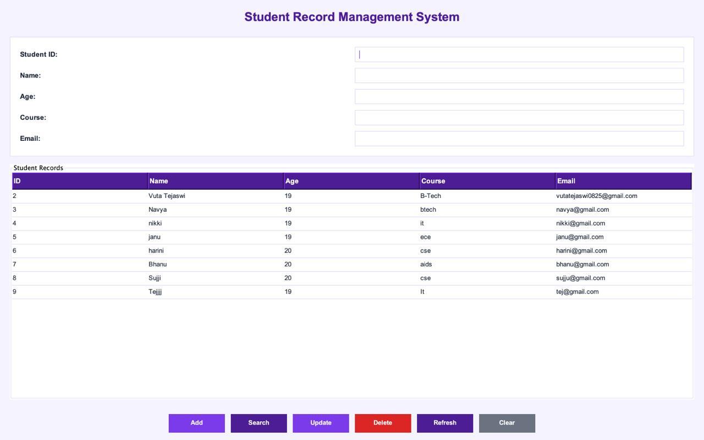

# Student Record Management System

A Java-based Student Record Management System built using Java, JDBC, MySQL, and Java Swing. The project provides a command-line application and a graphical user interface for managing student records.

## Features

- Add new student records
- View all student records
- Search students by ID
- Update student details
- Delete student records with confirmation
- Input validation and error handling
- Database connectivity using JDBC
- Modern Purple graphical user interface
- Interactive student table with row selection
- Refresh records and clear input fields

## Technologies Used

- Java
- Java Swing
- MySQL 9.4
- JDBC
- MySQL Connector/J
- Visual Studio Code
- Git and GitHub

## Database Setup

1. Create a MySQL database named `student_db`.
2. Create a `students` table with the columns `id`, `name`, `age`, `course`, and `email`.
3. Create a dedicated MySQL application user and grant the required permissions.
4. Configure your database credentials in a local `.env` file.
5. Ensure MySQL is running before launching the application.

**Security:** Never upload `.env` or expose database passwords in source code. Keep credentials private.

## Project Structure

```text
StudentManagementSystem/
├── .gitignore
├── README.md
├── .env
├── lib/
│   └── mysql-connector-j-26.10.0.jar
├── src/
│   ├── DBConnection.java
│   ├── Main.java
│   ├── StudentManagementGUI.java
│   ├── TestConnection.java
│   ├── ViewStudents.java
│   ├── SearchStudent.java
│   ├── UpdateStudent.java
│   └── DeleteStudent.java
├── Screenshots/
└── out/
```

## Run the Command-Line Application

From the project root, compile:

```bash
javac -cp "lib/*:out" -d out src/Main.java
```

Run:

```bash
java -cp "out:lib/*" src.Main
```

## Run the Graphical User Interface

Compile:

```bash
javac -cp "lib/*" -d out src/DBConnection.java src/StudentManagementGUI.java
```

Run:

```bash
java -cp "out:lib/*" src.StudentManagementGUI
```

Ensure MySQL is running and the local database credentials are configured before launching either application.

## Screenshots

Add screenshots of the graphical interface to the `Screenshots/` folder and link them here.

Example:

```markdown

```

## Author

Student project developed to practice Java programming, JDBC, MySQL database operations, and GUI development.


## Application Screenshot


